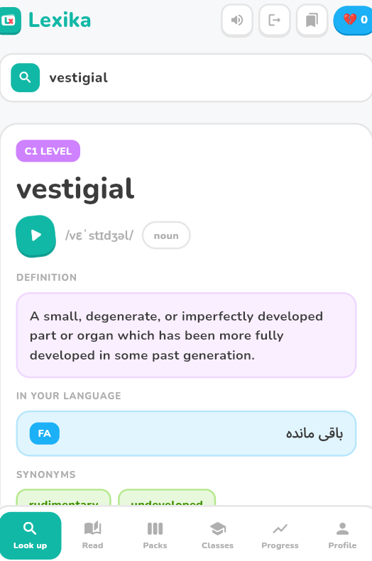
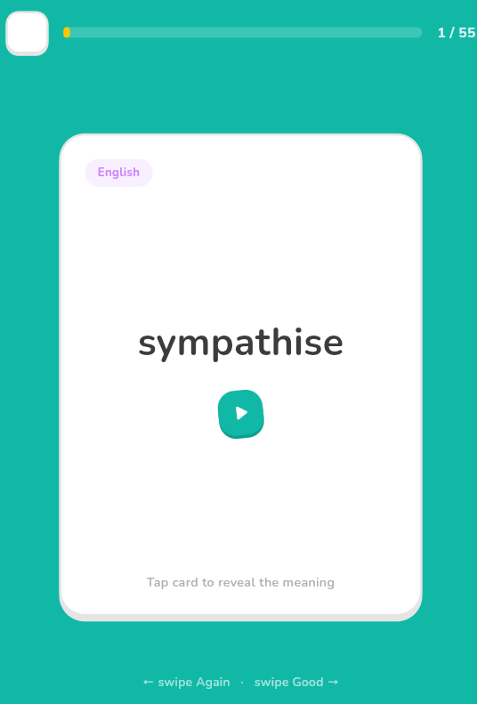

  

  
  
  
  
  
  
  

 

## 🛠️ Things I ship

<table>
  <tr>
    <td width="50%" valign="top">
      
      <h3> <a href="https://github.com/teslaoruz/cove">Cove</a></h3>
      Every project you code, one click from a coding agent. Finds the projects on your disk and remembers every Claude Code, Codex and opencode session in them.
        
      <code>Rust</code> <code>Slint</code> <code>Linux</code> <code>Windows</code>
    </td>
    <td width="50%" valign="top">
      
      <h3>⚖️ <a href="https://mzn.af/mizan">Mizan</a></h3>
      Offline, encrypted, double-entry accounting for small shops: sales, bills, inventory and reports, with an Android companion. <a href="https://github.com/teslaoruz/mizan-releases">Downloads →</a>
        
      <code>C#</code> <code>.NET 9</code> <code>Avalonia</code> <code>MAUI</code>
    </td>
  </tr>
  <tr>
    <td width="50%" valign="top">
      

        
        
      

      <h3>📚 <a href="https://github.com/teslaoruz/lexika-releases">Lexika</a></h3>
      A playful English vocabulary app for Russian, Kazakh and Persian speakers. Look up any word, save it to a deck, lock it in with spaced repetition and mini-games.
        
      <code>Flutter</code> <code>FastAPI</code> <code>Android</code>
    </td>
    <td width="50%" valign="top">
      
      <h3>🧪 <a href="https://github.com/teslaoruz/TFCS-IELTS">TFCS-IELTS</a></h3>
      Scores IELTS essays fully offline. A three-tier cascade (TF-IDF + Ridge → DistilBERT → local Qwen2.5-3B with FAISS retrieval) sends only the hard essays to the LLM.
        
      <code>PyTorch</code> <code>Transformers</code> <code>RAG</code> <code>IEEE paper</code>
    </td>
  </tr>
</table>

## 🐧 Linux desktop toys

<table>
  <tr>
    <td width="33%" valign="top" align="center">
      
      <h4><a href="https://github.com/teslaoruz/emba">emba</a></h4>
      A little red panda that watches your coding agents: approve requests, follow sessions, answer questions.
    </td>
    <td width="33%" valign="top" align="center">
      
      <h4><a href="https://github.com/teslaoruz/bloom-bar">bloom-bar</a></h4>
      Claude Code status on your bar for caelestia and noctalia: live limits, sessions, a spinner.
    </td>
    <td width="33%" valign="top" align="center">
      
      <h4><a href="https://github.com/teslaoruz/bounce-saver">bounce-saver</a></h4>
      An OLED-safe bouncing-logo screensaver for Wayland, with a Noctalia plugin.
    </td>
  </tr>
</table>

## 🔬 More experiments

- **[fl-health](https://github.com/teslaoruz/fl-health)**: federated learning across simulated hospital silos to predict readmission, with differential privacy and no raw data shared.

 

built offline, mostly at night ☕

